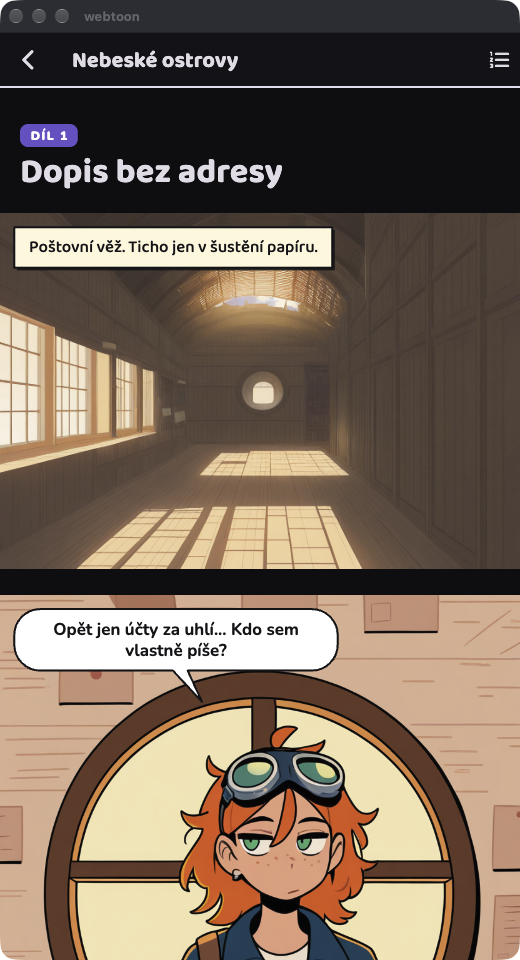

# Webtoon — Flutter klient: čtečka (M1/M2) + autor (M3)

Jedna aplikace pro obě role (WEBTOON_PLAN §5.5, §6): **čtenář** (seznam světů → detail světa →
„Začít kampaň“ → čtečka) i **autor/DM** (záložka „Tvořit“: editor světa, knihovna postav a lokací,
kánon, dashboard). Autor a hráč se liší jen vlastnictvím světa (`owner_id == X-User-ID`). Panely jsou obrázky z backendu (`/media/...`),
bubliny a SFX se kreslí ve Flutteru jako overlay, takže jdou upravit bez regenerace obrázku.



## Spuštění

```sh
# backend (viz ../backend/README.md); jen API, bez workeru = nic negeneruje
cd ../backend && docker compose up -d db
MODE=api WORKERS=0 go run ./cmd/webtoon serve            # :8095

# demo díl z výstupů M0 (bez LLM / ComfyUI): vytvoří kampaň hráče "player" s hotovým dílem
go run ./cmd/webtoon import-demo -player player \
  ../out/dev/storyboard_ep1.json ../out/2026-10-17/ep1_noob_plain

# aplikace
cd ../app
flutter run -d macos \
  --dart-define=WEBTOON_API=http://localhost:8095 \
  --dart-define=WEBTOON_USER=player
```

| `--dart-define` | výchozí | |
|---|---|---|
| `WEBTOON_API` | `http://localhost:8095` | URL backendu (výchozí `LISTEN_ADDR` backendu je `:8095`) |
| `WEBTOON_USER` | `player` | posílá se jako `X-User-ID` (auth je zatím stub) |
| `WEBTOON_OPEN_CAMPAIGN` | – | jen pro vývoj: po startu rovnou otevře čtečku kampaně `cp_…` |

Web (Chrome): backend musí povolit origin, např. `WEBTOON_CORS_ORIGINS=http://localhost:8096`.

```sh
flutter build web --dart-define=WEBTOON_API=http://localhost:8095 --dart-define=WEBTOON_USER=player
python3 -m http.server 8096 -d build/web
```

Android emulátor: `WEBTOON_API=http://10.0.2.2:8095`. Na dev backend se chodí přes čisté http:
Android má `usesCleartextTraffic`, iOS `NSAllowsLocalNetworking` (localhost, `.local`), macOS
entitlement `network.client`.

## Testy

```sh
flutter analyze
flutter test
```

- `test/bubble_layout_test.dart`: rozmístění bublin (heuristika z `m0/compose.py`, škálování, žádné
  překryvy, ocásky, cesta přes `bbox`/`anchor`), tvary bublin, `PanelView`.
- `test/reader_test.dart`: čtečka nad `FakeWebtoonApi` (`test/fake_api.dart`): hotový díl, mezery
  `gap_after`, blok voleb a cena, sledování nového dílu, polling generování s postupným
  zobrazováním panelů, regenerace selhaného panelu, úprava bubliny (PATCH), režie, chyby, historie.
- `test/api_test.dart`: HTTP klient (hlavičky, těla požadavků, české chyby, tvar `GET /episodes/{id}`).
- `test/screens_test.dart`: světy → detail → kampaň → čtečka; seznam kampaní.
- `test/author_test.dart`: autor nad `FakeWebtoonApi`: Tvořit + nový svět, uložení základu/stylu/práv
  (PATCH tělo), pravidla/frakce/kánon (přeřazení, id uzlů zůstávají)/mantinely, generování tagů a úprava
  čipů (smazat, vrátit vyřazený, přidat) → `tag_prompt`, LLM mimo rozvrh (503), character sheet
  (fronta + „waiting“, průběh k/n, výsledky, nejlepší → reference, polling skončí), upload/přeřazení/
  odebrání referencí, limit 8 MiB, IP-Adapter nastavení, nová postava + smazání, lokace, dashboard,
  „Zahraj si vlastní svět“, „Upravit“ v detailu světa.
- `integration_test/author_live_test.dart`: autor **proti živému backendu** (bez fake): nový svět, základ,
  styl, práva, pravidlo + uzel kánonu, nová postava, tagy, LLM tlačítko (tagy, nebo česká hláška když LLM
  neběží), upload reference postavy i lokace, dashboard; po každém kroku ověří stav přes API. Negeneruje
  nic na GPU (žádný sheet ani kampaň). Spuštění: backend `MODE=api`, pak
  `flutter test integration_test/author_live_test.dart -d macos --dart-define=WEBTOON_API=http://localhost:8095 --dart-define=WEBTOON_USER=author_live`.
- `test/api_test.dart` navíc: autorské endpointy (cesty, těla, multipart `file`, 204 u DELETE, parsování
  `stats`, `sheet`, `ip_adapter`, `reference_urls`, frakcí).

## Struktura

```
lib/
  main.dart, app.dart          ProviderScope, téma (světlé/tmavé), záložky Světy / Kampaně / Tvořit
  config.dart                  --dart-define (API, uživatel, poll interval)
  theme.dart                   fonty (Nunito, Nunito Italic, DynaPuff, Baloo 2), komiksové barvy a karty
  api/webtoon_api.dart         rozhraní WebtoonApi + ApiException + české chybové hlášky
  api/http_webtoon_api.dart    implementace nad package:http
  models/                      world (+ kánon, frakce, reference, ip_adapter), campaign, episode,
                               author (style presety, návrh tagů, character sheet, stats); lenient JSON
  providers/                   Riverpod: světy, kampaně, EpisodeNotifier (polling), ReaderNotifier,
                               moje světy, style presety, stats, imagePickerProvider (v testech fake)
  reader/
    bubble_layout.dart         rozmístění bublin a ocásků (čistá funkce, testovaná)
    bubble_painter.dart        tvary: řeč, myšlenka (obláček + bublinky), křik (výbuch), narace (rámeček)
    panel_view.dart            panel = obrázek + SFX + bubliny (Stack), placeholdery, „Vygenerovat znovu“
    episode_view.dart          jeden díl: titulek, progres generování, panely s mezerami, „Zvoleno: …“
    episode_end_block.dart     volby, volný text, režie (jen když to permissions dovolí), cena v kreditech
    bubble_edit_dialog.dart    úprava textu bubliny (dlouhý stisk)
  screens/                     worlds, world_detail (+ výběr postavy, „Upravit“ pro autora), campaigns, reader
  author/
    create_screen.dart         záložka Tvořit: moje světy, dialog „Nový svět“ (název + styl)
    world_editor_screen.dart   editor světa: Základ / Lore & kánon / Postavy / Lokace / Přehled, výběr stylu
    character_editor_screen.dart  postava: info, tagy (čipy), identita (+ IP-Adapter), sheet, reference
    location_editor_screen.dart   lokace: info, tagy, reference
    sheet_panel.dart           character sheet: POST …/sheet, polling GET /sheets/{id}, výsledky
    dashboard_view.dart        přehled z GET /worlds/{id}/stats
    author_widgets.dart        TagChipsEditor, ReferenceImagesEditor, StringListEditor, …
  services/push_notifications.dart   TODO rozhraní (zatím Noop, čtečka polluje)
  services/image_picker.dart   výběr PNG/JPEG přes file_selector (macOS: entitlement files.user-selected.read-only)
assets/fonts/                  kopie ../assets/fonts včetně OFL licencí
```

## Jak funguje čtečka

- **Jeden scroll přes celou kampaň.** `CustomScrollView` s `center` na zaostřeném dílu (výchozí
  poslední): dřívější díly jsou nad ním (scroll nahoru), pod posledním je blok voleb. Historie dílů
  (ikona v app baru) přesune zaostření na vybraný díl.
- **Mezery** podle `gap_after`: small/medium/large = 40/140/320 px při šířce pásu 800, škálované na
  skutečnou šířku (pás má max. 800 logických px a na širokém okně je na středu).
- **Bubliny** (`layoutBubbles`): stejně jako `compose.py` — narace jako rámeček vlevo nahoře
  (max. 80 % šířky), řečové bubliny max. 62 % šířky střídavě v horních rozích (s narací první vpravo),
  pravý sloupec o 40 px níž, ocásek 48 px dolů a 40 px ke středu; písmo 26 px (křik 30 px) při šířce 800.
  Navíc: sloupce se skládají pod sebe a bublina, která by se překryla s jinou, se posune pod ni.
  Až backend začne posílat `characters[].bbox` (`[x, y, w, h]` nebo `{x, y, w, h}`, 0–1 nebo pixely
  obrázku), bublina si vybere roh, který zakrývá nejmíň postav, a ocásek míří na hlavu mluvčího.
  Explicitní `anchor {x, y}` u bubliny má přednost.
- **Generování:** `EpisodeNotifier` polluje `GET /episodes/{id}` každé 2 s, dokud je díl
  `queued`/`generating` nebo se některý panel kreslí; hotové panely se objevují postupně, nad nimi je
  progres (fronta → scénář → panely k/n; „waiting: …“ = GPU server mimo rozvrh).
- **Selhaný panel** má placeholder s „Vygenerovat znovu“ (`PATCH … {"regenerate": true}`), selhaný díl
  nabídne znovu volby předchozího hotového dílu.
- **Konec dílu:** uzavřené volby jako tlačítka, pole „Nebo napiš, co uděláš…“, cena (= počet panelů,
  odhad podle aktuálního dílu) v potvrzovacím dialogu; `POST /campaigns/{id}/episodes` a čtečka
  přeskočí na nový díl. Sekce „Režie“ (přidat/odebrat postavu, změnit lokaci) se ukáže jen když
  `world.permissions` dovolí `can_add_characters` / `can_change_location`; posílá se jako `director`
  (backend ho zatím ignoruje).
- **Úpravy textu:** dlouhý stisk na bublině → dialog → `PATCH /episodes/{id}/panels/{n}` se všemi
  bublinami panelu (optimisticky, při chybě se vrátí). Jen pro hráče kampaně.

## Autor (záložka „Tvořit“)

- **Moje světy** (`GET /worlds?owner=me`) a **Nový svět**: název + style preset → `POST /worlds` → editor.
  Vlastní svět jde otevřít i z detailu světa (ikona tužky, jen pro vlastníka).
- **Editor světa** (`PATCH /worlds/{id}`, tlačítko „Uložit“ v app baru):
  - *Základ*: název, synopse, tón, jazyk, publikum (děti/13+/dospělí), viditelnost, výtvarný styl
    (karty z `GET /style_presets`: artist + estetické tagy, checkpoint/sampler, náhled pokud má
    `preview_url`), co hráč smí (přepínače režie / vlastní postava / změna lokace, povolené lokace jako
    čipy — nic = všechny, max. dílů).
  - *Lore & kánon*: pravidla světa, frakce (`bible.rules`, `bible.factions` jako seznamy textů; ostatní
    klíče `bible` se zachovají), kanonické uzly (přetažení nebo šipky; existující `id` se posílají dál,
    nové bez `id` — přidělí je backend, `canon_progress` kampaní tak platí dál), mantinely (volný text).
  - *Postavy* / *Lokace*: knihovny → editory níže, „Nová postava“ / „Nová lokace“.
  - *Přehled*: dashboard (počty, kde hráči skončili, volby po dílech, průchod kánonem, postavy hráčů) a
    „Zahraj si vlastní svět“ (také ikona v app baru) = běžná kampaň přes `POST /campaigns`.
- **Postava**: jméno, role (NPC / hratelná), dívka/chlapec (`count_tag`), popis vzhledu, povaha, styl řeči.
  „Vygenerovat tagy“ (`POST …/tag_prompt`) nahradí čipy návrhem LLM; vyřazené tagy (mimo slovník WD14)
  jsou šedé a přeškrtnuté, klepnutím se přidají. Čipy jdou mazat a přidávat; uloží se jako `tag_prompt`
  spolu s ostatním (`PATCH`). Identita: jen tagy / IP-Adapter (preset, váha 0–1,5, end_at 0–1) / LoRA.
  „Vygenerovat character sheet“ zařadí job, karta polluje stav (fronta, „waiting: …“ když je GPU server
  mimo rozvrh, k/n), ukáže varianty se shodou tagů, nejlepší zvýrazní a po dokončení načte reference.
  Reference: náhledy, „použít jako hlavní“ (první = IP-Adapter), odebrat (`PATCH reference_images`),
  „Nahrát obrázek“ (multipart, PNG/JPEG, max. 8 MiB, kontroluje se i v aplikaci).
  Generování, sheet a reference jsou k dispozici po prvním uložení postavy. Smazání v app baru.
- **Lokace**: název, popis, nálada, tagy scény (stejné čipy + generování), reference, smazání.

## Co chybí

- Push notifikace (jen rozhraní `PushNotifications`), export dílu (PNG/PDF/share), kredity jako zůstatek.
- Tvorba vlastní postavy (`can_create_character`) při startu kampaně — zatím jen výběr hratelných postav.
- Autor: náhledy style presetů závisí na `preview_url` z backendu; nastavení `identity_asset` (LoRA) a
  editace `count_tag` pro víc postav (jen dívka/chlapec/jiné); přeřazení postav/lokací v knihovně.
- Autor: neuložené změny se při odchodu z editoru neohlídají (žádný „zahodit změny?“ dialog).
